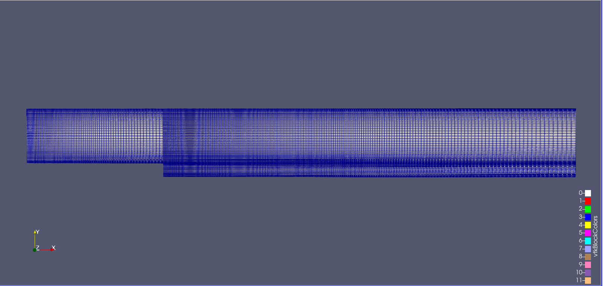
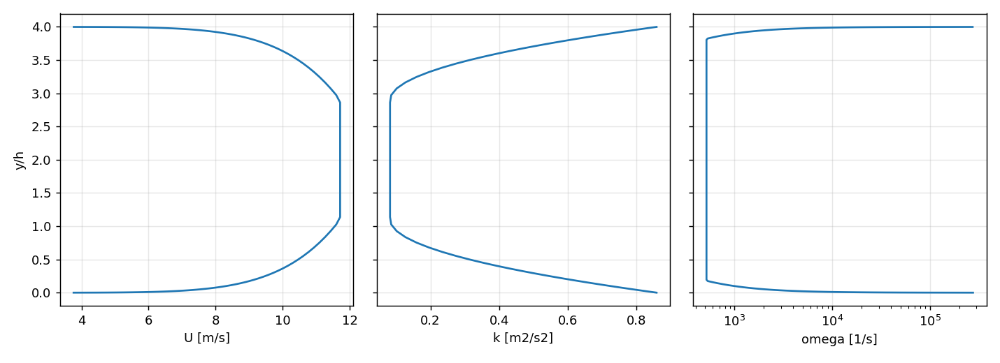
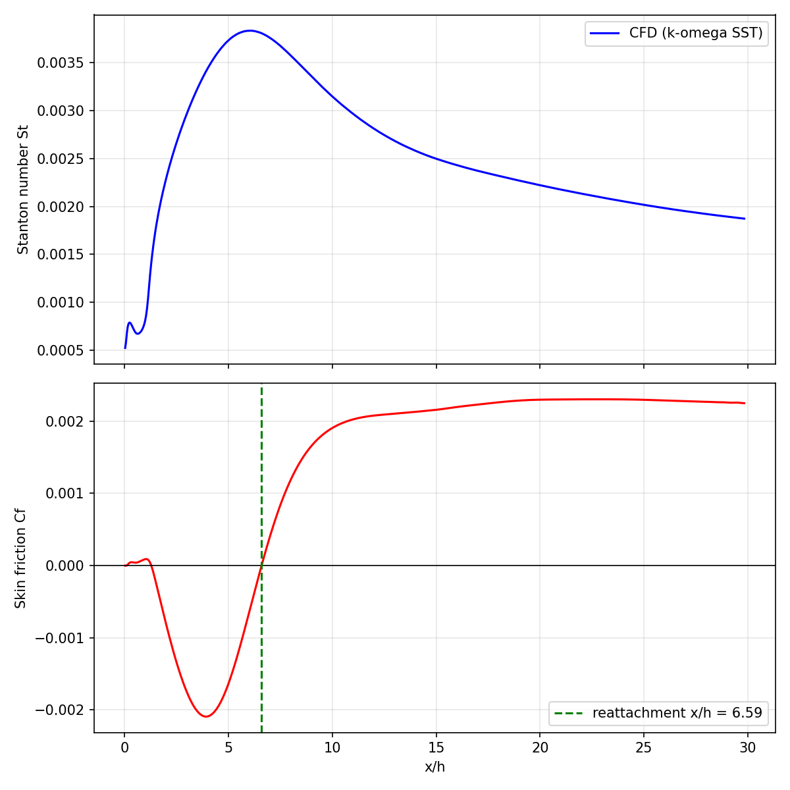
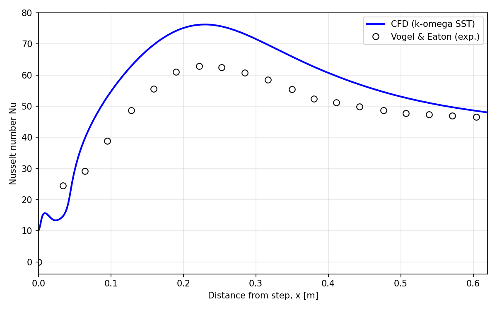
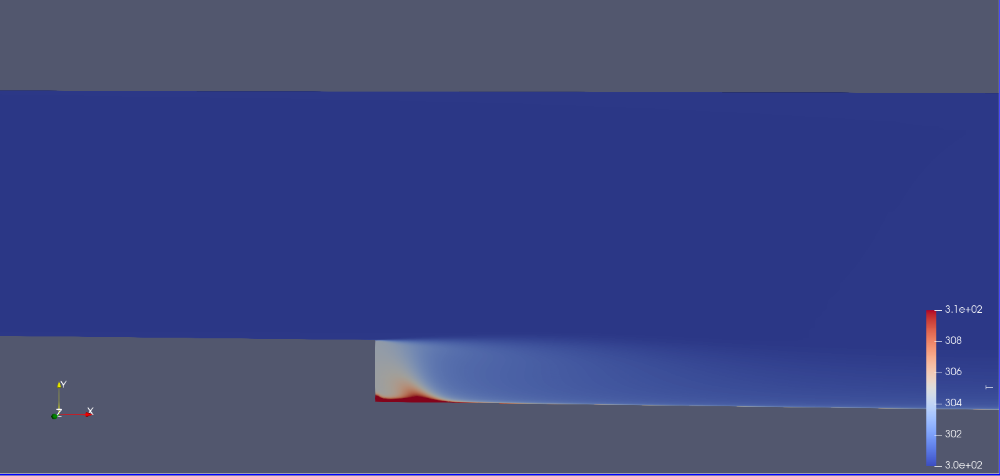

# Turbulent Forced Convection over a Heated Backward-Facing Step

RANS simulation of the Vogel & Eaton (1985) backward-facing step with heat transfer, run in OpenFOAM 13 and validated against the experimental Nusselt number distribution (Ansys verification case VMFL013).

---

## 1. Physical problem

Air flows through a channel of height 4h and expands suddenly into a channel of height 5h (expansion ratio 1.25). The flow separates at the step edge, forms a recirculation bubble, and reattaches on the downstream floor. That floor carries a uniform heat flux, so the local heat transfer is strongly affected by the separated and reattaching shear layer. Heat transfer peaks close to the reattachment point, which makes the case a standard test of RANS turbulence and heat-transfer modelling.

| Parameter | Value |
|---|---|
| Step height, h | 0.0381 m |
| Upstream channel height | 4h = 0.1524 m |
| Downstream channel height | 5h = 0.1905 m |
| Upstream length | 10h |
| Downstream length | 30h |
| Reynolds number, Re_h | 28,000 (based on h and free-stream velocity) |
| Free-stream velocity | 11.71 m/s |
| Fluid | Air, ideal gas, constant properties |
| Inlet temperature | 300 K |
| Heated wall | Uniform heat flux 270 W/m², downstream floor only |
| Other walls | No-slip, adiabatic |
| Prandtl number | 0.71 |

**Figure 1: Flow domain and boundary conditions.**


---

## 2. Solver and models

| Item | Setting |
|---|---|
| Code | OpenFOAM 13 |
| Application | `foamRun`, module `fluid` (steady, energy equation solved) |
| Pressure-velocity coupling | PIMPLE in SIMPLE mode, `consistent yes`, one outer corrector |
| Turbulence model | k-ω SST |
| Wall treatment | `kLowReWallFunction`, `omegaWallFunction`, `nutUSpaldingWallFunction` (low-Re, y+ ≈ 1) |
| Turbulent Prandtl number | 0.85 (`compressible::alphatWallFunction`) |
| Thermophysics | `heRhoThermo`, `perfectGas`, `hConst`, μ = 1.85×10⁻⁵ Pa·s, Cp = 1005 J/(kg·K), Pr = 0.71 |
| Time stepping | Steady state, 5000 iterations |
| Convection schemes | Momentum: `bounded Gauss linearUpwind`; energy, k, omega: `bounded Gauss upwind` |
| Heated wall condition | `externalWallHeatFluxTemperature`, mode `flux`, q = 270 W/m² |
| Outlet | Fixed static pressure 10⁵ Pa |
| Inlet | Uniform 11.5 m/s in the first run. Final run: 1/7-power-law boundary layer, delta = 1.1h on both walls, free-stream U = 11.71 m/s, with matching k and Omega profiles (`inletProfile.py`) |

The Mach number is about 0.03, so compressibility effects are negligible. The `fluid` module was chosen because the incompressible module does not solve for temperature.

---

## 3. Mesh

| Item | Value |
|---|---|
| Type | Structured, multi-block, 2D hexahedral (one cell in z, `empty` front and back) |
| Generator | `blockMesh` (3 blocks) |
| Total cells | 52,000 |
| Points | 105,002 |
| First cell height at walls | ≈ 0.03 mm |
| Wall-normal grading | Symmetric geometric grading, y+ ≈ 1 |
| Streamwise grading | Finer near the step, coarser downstream |
| Max aspect ratio | 428 |
| Non-orthogonality | 0 (max and average) |
| Max skewness | 2×10⁻¹³ |
| `checkMesh` | Mesh OK |

**y+ on the walls (uniform-inlet run):**

| Patch | min | max | average |
|---|---|---|---|
| heatedWall | 0.007 | 0.37 | 0.28 |
| topWall | 0.38 | 1.68 | 0.46 |
| stepWall | 0.010 | 8.2 | 1.22 |

The maximum on `stepWall` is localised at the step corner. On the heated wall, which controls the heat transfer result, the viscous sublayer is fully resolved.

**Figure 2: Computational mesh.**



---

## 4. Inlet condition


- Velocity: 1/7 power law, U = U_inf (d/delta)^(1/7), with d the distance to the nearest wall and delta = 1.1h.
- k: free-stream level (2% intensity) plus a near-wall contribution from an estimated friction velocity.
- Omega: free stream from nu_t/ν = 10, near wall from a mixing-length estimate.

**Figure 4: Inlet profiles of U, k and Omega.**


---

## 5. Results and validation

### 5.1 Flow field

Reattachment was located from the sign change of the wall shear stress on the heated wall.

| Quantity | CFD | Experiment |
|---|---|---|
| Reattachment length x_r/h | 6.59 | about 6.7 |

The small positive wall shear and the dip in Nu close to the step (x/h < 1.2) are the secondary corner eddy.

**Figure 5: Stanton number and skin friction along the heated wall.**



### 5.2 Heat transfer

The CFD Stanton number was converted to a Nusselt number using Nu = St · Re_h · Pr, which equals q·h / (k·(T_w − T_in)). It was compared with the experimental Nu distribution tabulated in the Ansys verification document (VMFL013). The Ansys fluid properties (ρ = 1, μ = 10⁻⁴, k = 1.408, Cp = 10⁴) give Pr = 0.71, the same as here, so with Re_h matched the Nusselt numbers are directly comparable.

| Quantity | CFD | Experiment | Difference |
|---|---|---|---|
| Peak Nu | 76.2 **[UPDATE]** | 62.8 | +21% |
| Peak location x/h | 6.04 **[UPDATE]** | 5.83 | +0.2 |
| Mean absolute error | 20% **[UPDATE]** | | |
| Error at x/h ≈ 16 | +4% **[UPDATE]** | | |

**Figure 6: Nusselt number, CFD against experiment.**




### 5.3 Temperature field

**Figure 7: Temperature contours near the heated wall.**



---

## 6. Limitations

- No mesh-independence study has been performed. A coarser and a finer mesh should be run to quantify discretisation error.
- The experimental data are values taken from the Ansys verification document, not from the original paper.
- The k and ω inlet profiles are estimates, not taken from a precursor channel simulation.
- Constant fluid properties and Pr_t = 0.85 are assumed. Heat transfer in the reattachment region is sensitive to Pr_t.
- Convergence was judged from the iteration count and residuals, so confirm that Nu is unchanged between the last written times.

---

## 7. Reproducing the results

```bash
# 1. Mesh
blockMesh
checkMesh

# 2. Impose the boundary-layer inlet (needs cell centres from an earlier run,
#    or run the first iteration and write them)
foamPostProcess -latestTime -func writeCellCentres
python inletProfile.py

# 3. Solve
foamRun | tee log.foamRun

# 4. Post-process
foamPostProcess -latestTime -func writeCellCentres
foamPostProcess -solver fluid -latestTime -func wallShearStress
foamPostProcess -solver fluid -latestTime -func yPlus
python postprocessing.py --U 11.711     # reattachment length, St, Cf -> bfs_results.csv/png
python compareNu.py                     # Nu against Vogel & Eaton -> nu_comparison.png
```

## 8. Files

| File | Purpose |
|---|---|
| `system/blockMeshDict` | Geometry and mesh |
| `constant/physicalProperties` | Air thermophysical properties |
| `constant/momentumTransport` | k-ω SST |
| `0/` | Initial and boundary conditions (U, p, T, k, omega, nut, alphat) |
| `inletProfile.py` | Writes the boundary-layer inlet profile into `0/` |
| `postprocessing.py` | Reattachment length, Stanton number, skin friction |
| `compareNu.py` | Nu conversion and comparison with experiment |

## 9. Reference

J. C. Vogel and J. K. Eaton, "Combined Heat Transfer and Fluid Dynamic Measurements Downstream of a Backward-Facing Step", *Journal of Heat Transfer*, Vol. 107, pp. 922-929, 1985.

Ansys Fluent and CFX Verification Manual, case VMFL013: Turbulent Flow with Heat Transfer in a Backward-Facing Step.
